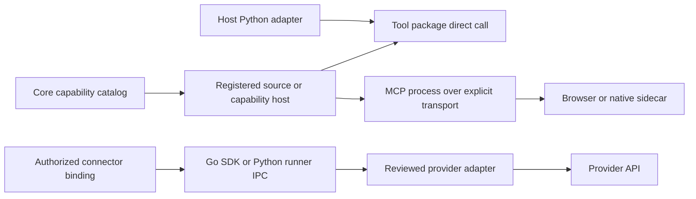

# Tools components, hosts and runners

Source map reviewed **2 November 2026**. Read [agnostic architecture](AGNOSTICISM.md).
Tools is independent of the reasoning engine and any embedding application.

## Repository and package organization

| Directory / distribution | Responsibility and communication |
| --- | --- |
| `packages/tool-protocol/` / `openagent-tool-protocol` | Neutral manifests, risk classification, full ToolResult and optional MCP transport |
| `packages/mcp-client/` / `openagent-mcp-client` | Independent operation-scoped official MCP SDK client; typed errors, bounded catalogs and cancellation preservation |
| [`packages/media-inspector/`](../packages/media-inspector/README.md) / `openagent-media-inspector` | Private HTTP and direct Python media previews from authorized bytes; no agent loop, provider credential or document store |
| `packages/filesystem/` / `openagent-filesystem` | FilesystemServer; direct Python calls or MCP stdio |
| `packages/editor/` / `openagent-editor` | EditorServer, structured edits and search; direct calls or MCP stdio |
| `packages/shell/` / `openagent-shell` | ShellServer and owned process lifecycle; direct calls or MCP stdio |
| `packages/execution/` / `openagent-execution` | ProcessCodeExecutor with explicit local, Docker or SSH backend; no agent loop |
| `packages/device-tools/` / `openagent-device-tools` | Sidecar manifests/discovery and registration adapters |
| `sidecars/computer-control/` | Rust/native computer-control process, platform accessibility/input/capture |
| `sidecars/agent-in-chrome/host/` | Node browser MCP, dedicated browser/CDP lifecycle and approval protocol |
| `packages/web-search/` | Independent web-search MCP; explicitly provisioned browser when required |
| `packages/connectors/` | Shared Go catalog, adapters, authorized runtime, connector runner and auth broker |
| `packages/connectors-python/` / `openagent-connectors` | Python adapter and runner IPC for the same shared connector contract |
| `packages/meta-ads-mcp-server/` | Independent provider MCP implementation |
| `scripts/`, `packaging/`, `docs/qualification/` | Build/qualification inputs and evidence; not consumer deployment configuration |

Public protocol types do not import Core. Filesystem/editor/shell do not require
the standalone product. `openagent-capability-host` belongs to **Core**, not this
repository; it can host these providers without an engine. The standalone
`openagent-host-tools` compatibility/facade package belongs to **openagent** and
composes the generic providers. Neither is a second implementation of a tool.

## The three execution paths

A direct tool call is not a Core run or an authorization service. The host must
validate identity, permission, scope, arguments and result audience before
exposing it. A Core registration binds a source and generation to that authorized
executor; a name or path supplied by a model cannot select another destination.
MCP stdio is a transport; writing a module does not require copying a model loop.

## Distinguish the runners

- **Agent runner:** Core Runtime plus an executor; admits, records and supervises
  agent work. It is not implemented in Tools.
- **Code executor:** `ProcessCodeExecutor`; runs a command in the backend selected
  by trusted host configuration. The host owns sandbox provisioning and budgets.
- **Native/browser sidecar:** a process owning its exact device/browser resources.
  The facade selects verified artifacts, not an arbitrary consumer-local binary.
- **Connector runner:** shared Go adapters exposed as trusted server IPC through
  `openagent-connector-runner`. The Python adapter passes bound credentials
  separately from tool arguments. It is not a public network endpoint.
- **Connector auth broker:** optional shared consent/exchange coordination;
  normal provider data traffic and host account authorization remain with the host.

Different providers may require reusable protocol-specific adapters. That does
not permit an adapter or branch for a particular embedding application.

## Protocol, effects and ownership

`ToolManifest` declares schema and conservative effect classification;
`ToolResult` retains full content, structured output, metadata and errors.
Preserve uncertain mutation outcomes rather than choosing another executor or
replaying a write. Device consent, process generation and current capability
catalog must still match when publishing a result. Host-owned authorization
cannot be supplied by tool arguments or reconstructed from a saved transcript.

Use explicit per-instance cwd, allowed roots, environment and isolation settings.
Some direct capabilities are unrestricted unless the host supplies limits;
running an MCP process under a privileged account does not make it a sandbox.
Install and verify sidecar artifacts separately; importing Tools starts none.

See [usage examples](USAGE.md), [connector contracts](../packages/connectors/README.md),
[browser protocol](browser-advanced.md), [native accessibility](native-accessibility.md),
and [Core composition](https://github.com/openagent-uno/openagent-core/blob/main/docs/COMPONENTS.md).

- [Desktop execution, live media and native artifacts](desktop-tools.md)
